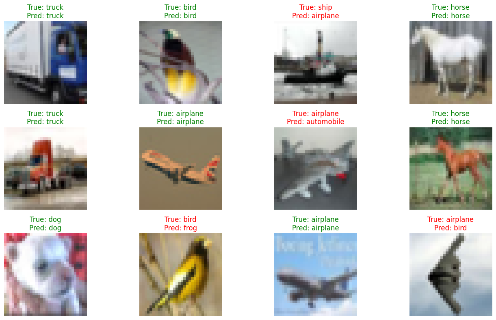
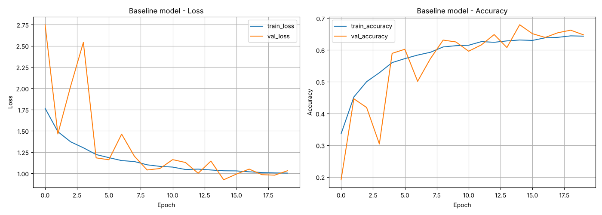
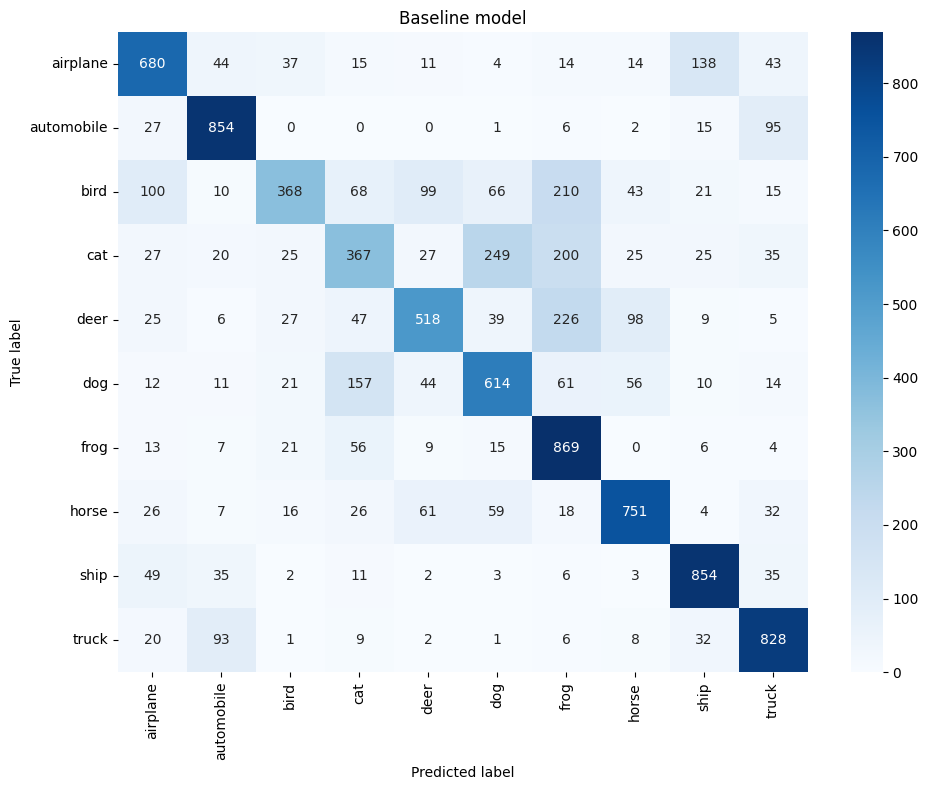

# CIFAR-10 Image Classification with a Custom CNN

A convolutional neural network built from scratch in TensorFlow/Keras to classify 32×32 RGB images into 10 classes. The project compares a baseline architecture with a lightweight one on accuracy, F1 and inference speed, and ships a Gradio web demo packaged in Docker.



## Results

| Model | Parameters | Train time | Test accuracy | F1 (macro) | Inference speed |
|---|--:|--:|--:|--:|--:|
| **baseline_model** | 111,946 | 141 s | **67.0%** | **0.66** | 16,907 img/s |
| fast_model | 28,394 | 21 s | 27.9% | 0.25 | 6,933 img/s |

Trained on a single GPU in Google Colab (45,000 train / 5,000 validation / 10,000 test images).

The baseline model is the clear winner. The lightweight model has 4× fewer parameters, but early stopping ended its training after 5 epochs, so it is undertrained. Its lower measured throughput also suggests the speed test was affected by GPU warm-up order. See [Next steps](#next-steps).

<table>
<tr>
<td></td>
</tr>
<tr>
<td></td>
</tr>
</table>

## Approach

- **Data:** CIFAR-10 (60,000 images, 10 classes), pixels scaled to [0, 1], 5,000 training images held out for validation.
- **Augmentation:** random horizontal flip, rotation (±5%) and zoom (±10%).
- **Architecture:** three `Conv2D → (BatchNorm) → ReLU → MaxPool` blocks, then `GlobalAveragePooling2D → Dropout → Dense → Dropout → Softmax`.

  | | Filters | Dense units | BatchNorm | Dropout |
  |---|---|--:|:-:|--:|
  | baseline_model | 32 / 64 / 128 | 128 | ✓ | 0.3 |
  | fast_model | 16 / 32 / 64 | 64 | — | 0.2 |

- **Training:** Adam (lr 1e-3), sparse categorical cross-entropy, batch size 128, up to 20 epochs with `EarlyStopping` and `ReduceLROnPlateau`.
- **Evaluation:** accuracy, F1-macro, F1-weighted, per-class report, confusion matrix and inference throughput (images per second).

## Project Structure

```
├── classification_cnn.ipynb   # full pipeline: data, models, training, evaluation
├── app.py                     # Gradio web demo
├── src/
│   └── predict.py             # model loading and inference helpers
├── models/                    # trained models (.keras)
├── results/                   # training history and model comparison table
├── images/                    # figures used in this README
├── requirements.txt
└── Dockerfile
```

## Quick Start

**Run the demo locally:**

```bash
pip install -r requirements.txt
python app.py
```

Then open http://127.0.0.1:7860 and upload an image.

**Run with Docker:**

```bash
docker build -t cnn-cifar10-gradio .
docker run -p 7860:7860 cnn-cifar10-gradio
```

**Retrain the models:** open `classification_cnn.ipynb` in Jupyter or [Google Colab](https://colab.research.google.com/) (GPU recommended) and run all cells. Models are saved to `models/`, metrics to `results/`.

To use a different model in the demo, set `MODEL_PATH`, e.g. `MODEL_PATH=models/fast_model.keras python app.py`.

## Next Steps

- Give each model its own callback instances and a longer patience so the lightweight model trains to convergence.
- Benchmark inference speed with a fixed warm-up and several repeated runs.
- Try deeper blocks (two convolutions per block) and stronger augmentation to push accuracy past 80%.
- Show the top-k predictions and a confusion matrix in the demo UI.

## Tech Stack

Python · TensorFlow / Keras · scikit-learn · pandas · Matplotlib / Seaborn · Gradio · Docker
